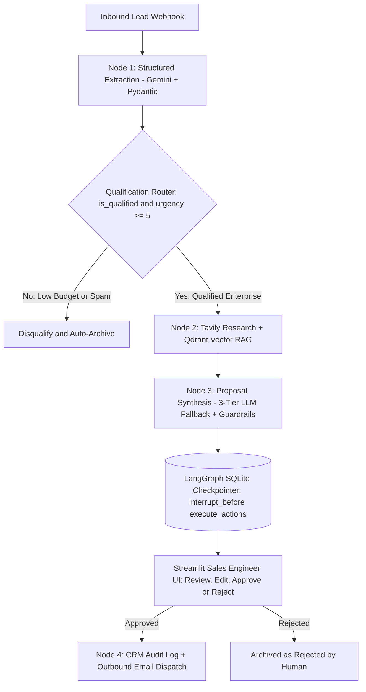

# Autonomous B2B Lead-to-Proposal & CRM Engine

[](https://www.python.org/)
[](https://github.com/langchain-ai/langgraph)
[](https://fastapi.tiangolo.com/)
[](https://qdrant.tech/)
[](https://streamlit.io/)

An event-driven **Agentic Sales Engineering System** that ingests inbound B2B inquiries via webhook, qualifies buyer intent, enriches company intelligence in real time, retrieves grounded SLA/compliance/pricing documentation via vector RAG, drafts structured technical proposals under strict Pydantic guardrails, and pauses at a **SQLite-persisted Human-in-the-Loop (HITL) checkpoint** before updating the CRM and dispatching outbound email.

---

## System Architecture



---

## Production Engineering Highlights

* **Durable Human-in-the-Loop (HITL) Checkpoints:** Compiled with `SqliteSaver` and `interrupt_before=["execute_actions"]` so high-value quotes (`$1,500+/mo`) persist safely across restarts and wait for human sign-off.
* **Deterministic Pydantic Guardrails:** Enforces `@field_validator` rules on `ProposalDraft` so the LLM can only output approved tiers (`Starter Tier`, `Growth Tier`, `Enterprise Tier`) and cannot quote below the `$1,500/month` minimum floor.
* **3-Tier Resilient LLM Fallback Chain:** Configured with automatic failover (`gemini-3.6-flash` -> `gemini-3.5-flash` -> `gemini-3.5-flash-lite`) to eliminate single-model rate-limit (`429`) and deadline (`504`) failures.
* **Grounded Enterprise RAG (`Qdrant` + `BAAI/bge-small-en-v1.5`):** Splits internal Markdown playbooks by header hierarchy and enforces mandatory source citations (`citations_used`) in every generated proposal.
* **Automated Regression Eval Suite (`evals/run_evals.py`):** Verifies qualification routing, tier selection, pricing floors, and citation grounding across enterprise, mid-market, student, and spam scenarios.

---

## Automated Evaluation Scorecard

Executed via `python3 -m evals.run_evals`:

| Test Scenario | Expected Routing | Actual Routing | Recommended Tier | Quoted Price | Grounded Citations | Status |
| :--- | :--- | :--- | :--- | :--- | :--- | :--- |
| **Healthcare Enterprise** (`HIPAA + SOC2`, `$15k/mo`) | Qualified | `True` | `Enterprise Tier` | `$12,000/mo` | `pricing_tiers.md`, `security_compliance.md` | **PASS** |
| **Series A Fintech** (`SOC2`, `$4.5k/mo`) | Qualified | `True` | `Growth Tier` | `$4,500/mo` | `pricing_tiers.md`, `security_compliance.md`, `case_study_fintech.md` | **PASS** |
| **Student Hackathon** (`$0` budget) | Disqualified | `False` | `None` | `$0/mo` | `[]` | **PASS** |
| **Job Seeker Spam** (Internship inquiry) | Disqualified | `False` | `None` | `$0/mo` | `[]` | **PASS** |

* **Routing & Guardrail Accuracy:** `4/4 (100%)`
* **Average End-to-End Pipeline Latency:** `27.28s`

---

## Repository Structure

```text
lead-to-proposal-agent/
├── app/
│   ├── api/main.py              # FastAPI endpoints (/webhooks/inbound-lead, /leads, /lead/{id}/review)
│   ├── graph/workflow.py        # LangGraph state machine, conditional routing, HITL checkpoints & fallbacks
│   ├── rag/vector_store.py      # Qdrant local vector DB ingestion & BAAI/bge-small-en-v1.5 retrieval
│   ├── schemas/models.py        # Pydantic models & @field_validator pricing/tier guardrails
│   └── tools/external_tools.py  # Tavily company enrichment & CRM/email execution handlers
├── data/                        # Internal pricing tiers, SLA, security compliance & case study docs
├── evals/run_evals.py           # Automated regression benchmark suite
├── ui/dashboard.py              # Streamlit 3-tab Sales Engineer Control Centre
├── .github/workflows/ci.yml     # GitHub Actions schema & import verification pipeline
├── Dockerfile                   # Multi-service container definition
├── docker-compose.yml           # One-command deployment orchestration
├── requirements.txt             # Pinned Python dependencies
└── README.md
```

---

## Quickstart (Local & Docker)

### Option A: Local Setup
```bash
git clone https://github.com/hskhola/lead-to-proposal-agent.git
cd lead-to-proposal-agent
cp .env.example .env
# Add GOOGLE_API_KEY and TAVILY_API_KEY inside .env

python3 -m venv venv
source venv/bin/activate
pip install -r requirements.txt

# Ingest internal knowledge base into Qdrant
python3 -m app.rag.vector_store

# Launch FastAPI backend (port 8000) & Streamlit UI (port 8501)
uvicorn app.api.main:app --port 8000 &
streamlit run ui/dashboard.py --server.port 8501
```
Open **`http://localhost:8501`** in your browser.

### Option B: Docker Compose
```bash
cp .env.example .env
docker compose up --build
```

### Run Automated Evaluations
```bash
python3 -m evals.run_evals
```

---

## API Reference

| Method | Endpoint | Description |
| :--- | :--- | :--- |
| `POST` | `/webhooks/inbound-lead` | Ingests an inbound lead JSON payload, runs extraction/enrichment/RAG/drafting, and pauses at HITL checkpoint. |
| `GET` | `/leads` | Returns all tracked lead threads, extracted intelligence, drafts, and checkpoint statuses. |
| `POST` | `/lead/{thread_id}/review` | Resumes the LangGraph thread with `approved` or `rejected` decision and edited Markdown proposal. |
